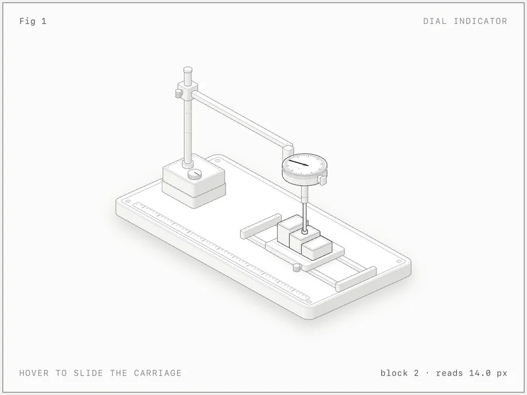

# 把复杂原理做成可交互的结构图

[单独下载这个技能](https://github.com/sanyetrio/trio-skills/raw/refs/heads/main/downloads/anatomy.zip) · [安装方法](https://github.com/sanyetrio/trio-skills/blob/main/docs/%E5%9F%BA%E7%A1%80%E9%85%8D%E7%BD%AE%E4%B8%8E%E5%AE%89%E8%A3%85.md) · [返回用途导航](https://github.com/sanyetrio/trio-skills)

适合写技术文章、做课程讲解或介绍产品原理时，把抽象概念变成能点击、拖动和观察变化的图。技能名：`anatomy`。

## 你给什么，得到什么

- **你给：** 要解释的概念、需要保留的真实参数，以及希望用于网页、文章还是演示。
- **你得到：** SVG 图、可在浏览器打开的交互 HTML，或 React 组件及可编辑源码；具体形式按你的请求确定。

可先打开[量表示例](examples/dial-indicator/dial-indicator-light.html)，看看本项处理的效果类型。

## 一句话使用

> 使用 anatomy，把“10 个连接被借出后，新请求需要排队等待”的数据库连接池原理做成浅色交互图，交付一个能在浏览器打开的 HTML 和源码。

## 只安装这一项

1. 下载本项的**完整目录**，文件夹命名为 `anatomy`。不要只下载 `SKILL.md`；`kit/`、`scripts/`、`references/` 等配套文件需要一起保留。
2. 把这个文件夹放入所用 AI 助手的技能目录。例如 Codex 的 `~/.codex/skills/`，或 Claude Code 的 `~/.claude/skills/`。
3. 重新打开会话，在 Codex 中输入 `$anatomy` 加上需求，在 Claude Code 中输入 `/anatomy` 加上需求。

本项独立使用，不必下载其他技能。

## 最低依赖

- 能读取技能、写文件并执行命令的 AI 助手。
- Node.js 20.10 或以上；Chrome / Chromium 用于截图和浏览器检查。
- 基础 SVG / HTML 绘图工具使用 Node.js 内置模块。选择 React 输出时，需要自己的 React 工程；选择 WebGL 效果时，需要支持 WebGL 的浏览器。

社区投稿是**可选功能**，不影响本地绘图。只有你明确要求投稿时才使用；该流程可能读取你自己的 Claude Code 会话来统计耗时和 token，具体见[来源说明](SOURCE.json)。

## 来源与说明

基于 [wheresryan22/anatomy](https://github.com/wheresryan22/anatomy/tree/bc943e40c59998be5da61f9d39c6a983b1116099)，固定提交 `bc943e40`，采用 [MIT 许可证](LICENSE)。保留上游示例、工具和许可；本次按用途整理补充中文入口，未修改绘图与投稿脚本。

[完整技能说明](SKILL.md) · [上游原版 README](UPSTREAM_README.md) · [来源与已有适配记录](SOURCE.json)
